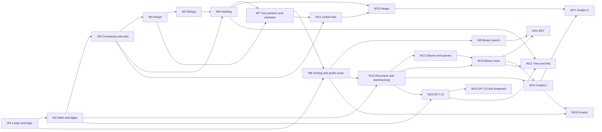

# DSA Pattern Path: a 26-Week Problem Ladder

Status: **built in the student app, not committed** (2026-11-07). D-1 to D-3 decided: one 26-group sheet, pattern
cards and per-problem notes shown in the app, and the path sits beside the DSA Sheet. The Library item (§5 step 3) is
still to be created in admin.
Date: 2026-11-07. Source: syllabus DSA stream (`docs/curriculum/RMS Careers 6 Months Plan.docx`, §4 week pages and
Appendix C) and the existing problem bank (`apps/student/lib/data/dsa-sheets.ts`, `dsa-problem-bank.ts`).

Evidence labels: **[V]** verified in the repository · **[P]** proposal · **[D]** decision still needed.

---

## 1. Summary

The current DSA Practice sheets (DSA Sheet 150, Blind 75, LeetCode 150) are **topic buckets**: problems grouped under a
pattern name, with no reason given for why one problem follows another. A beginner sees "Arrays: 10 problems" and
cannot tell which to start with or how problem 4 relates to problem 3.

The **Pattern Path** is an ordered ladder instead:

- **One pattern a week, in syllabus order.** Week N of the path is the pattern taught in DSA Lab N, so practice
  reinforces class instead of competing with it. Every syllabus lab problem (Weeks 1–21) is included and marked
  **L · Lab**.
- **Every problem says what it builds on.** Each row names the earlier idea it reuses and what is new about it. The
  new idea is always one step: a twist on the last problem, or two known ideas combined.
- **Old patterns come back on purpose.** Running sums (Week 1) return as prefix sums (Weeks 6 and 8). Happy Number's
  repeat detection (Week 3) returns as linked-list cycle detection (Week 11). Fibonacci (Week 2) returns as recursion
  (Week 10) and as DP (Week 19).
- **Difficulty rises slowly.** Weeks 1–4 are almost all Easy, with the first Mediums in Weeks 2 and 4. Before the
  interview sets, Hard problems are optional stretch problems, except one syllabus lab problem (Merge k Sorted Lists,
  Week 15).
- **Pattern recognition is trained, not assumed.** Each week opens with a pattern card (signal words, core move,
  common trap). Week 22 removes the labels, and Weeks 23–26 are interview-style mixed sets.

| | Count |
|---|---|
| Weeks | 26 |
| Problems in the path | 231 (209 core + 22 optional stretch) |
| Rows marked Lab | 105 (every syllabus lab problem; the syllabus counts the three tree traversals as one) |
| Already in the problem bank (progress carries over) | 195 |
| New problems to add | 36 (27 from LeetCode, 9 written by RMS) |
| Core difficulty (209) | 79 Easy · 124 Medium · 6 Hard |
| Stretch difficulty (22) | 11 Medium · 11 Hard |
| Problems per week | 4–13, most weeks 8–10 |

A student who finishes every core problem reaches **209 solved** by Demo Day. That is above the syllabus Placement
Readiness target of 150+ (syllabus §7.6), which asks for about 70 Easy, 70 Medium and 10 Hard. The core gives 79
Easy, 124 Medium and 6 Hard, so to meet the Hard target too a student solves at least 4 of the 11 Hard stretch
problems.

---

## 2. How a week is built

### 2.1 The ladder

Every week uses the same roles, in this order:

| Role | Meaning | Typical count |
|---|---|---|
| **R · Revisit** | A new problem from an earlier pattern that this week's pattern grows out of. Solved first, without notes. | 0–1 |
| **W · Warm-up** | The pattern in its plainest form. If this feels hard, re-read the pattern card. | 1–2 |
| **L · Lab** | The syllabus DSA Lab problems for this week (solved in class or self-practice). | 3–6 |
| **T · Twist** | Same pattern, one new wrinkle. | 1–3 |
| **X · Combine** | This week's pattern joined with an earlier one. Where pattern recognition is really built. | 1–2 |
| **S · Stretch** | Optional, harder. Never needed to stay on track. | 0–2 |

The **Builds on** column in every week table is the key to the design. It names the exact earlier problem or idea
being reused, so a student who is stuck knows what to go back to.

### 2.2 The pattern card

Each week opens with a four-line card. In the app it would be the sheet group's description (see §5).

- **Signal:** words or shapes in a problem statement that suggest this pattern.
- **Core move:** the one idea or template the pattern is built on.
- **Builds on:** the earlier weeks it needs.
- **Trap:** the most common beginner mistake.

### 2.3 Difficulty curve

| Weeks | Phase | Mix (core problems) | Hard problems |
|---|---|---|---|
| 1–4 | Logic, math, complexity, arrays | Almost all Easy; one Medium in Week 2 (Count Primes), three in Week 4 | None |
| 5–9 | Strings, hashing, two pointers, sorting, binary search | Easy → Medium, about half and half | Stretch only |
| 10–15 | Recursion, linked lists, stacks, trees, BST, heaps | Mostly Medium | Stretch only (one core: Merge k Sorted Lists) |
| 16–21 | Graphs, greedy, DP, tries and bits | Medium | Stretch only |
| 22 | Unlabelled mixed revision | Medium | None |
| 23–25 | Interview sets A, B, C | Medium with 2 Hard per set | Core |
| 26 | Final mock | Medium | None |

### 2.4 How the patterns depend on each other

Read it left to right: each arrow means "this week reuses that week's core move". Every pattern from Week 6 onward has
at least two parents, which is how newer patterns build on older ones.

---

## 3. The 26 weeks

Table columns: **#** order inside the week · **LC** LeetCode number (RMS = written by RMS Careers, no LeetCode page) ·
**Diff** E/M/H · **Role** from §2.1 · **Builds on** the earlier idea reused, then what is new · **Bank** ✓ already in
the problem bank, **new** to be added.

### Week 1 · Loops and conditions (Programming logic)

- **Signal:** "print", "for each", "repeat until", a pattern of stars or numbers.
- **Core move:** write the loop on paper first: what changes each time, and when does it stop?
- **Builds on:** nothing. This is the start.
- **Trap:** off-by-one errors in loop bounds. Hand-trace the first and last iteration.

| # | Problem | LC | Diff | Role | Builds on → what is new | Bank |
|---|---|---|---|---|---|---|
| 1 | Largest of Three Numbers | RMS | E | L | First if/elif/else: compare and keep the best. | new |
| 2 | Fizz Buzz | 412 | E | L | Conditions inside a loop; the order of checks matters (15 before 3 and 5). | new |
| 3 | Sum and Reverse of Digits | RMS | E | L | The digit loop: `% 10` takes the last digit, `// 10` removes it. Used again in Week 2. | new |
| 4 | Number of Steps to Reduce a Number to Zero | 1342 | E | T | A while loop whose action depends on the current value. | new |
| 5 | Star and Number Pyramids (5 variants) | RMS | E | L | Nested loops where the inner bound depends on the row: the shape of every O(n²) loop analysed in Week 3. | new |
| 6 | Running Sum of 1d Array | 1480 | E | X | Carry a running value across a loop. This exact idea becomes prefix sums in Weeks 6 and 8. | new |

### Week 2 · Math and digits

- **Signal:** digits, divisibility, primes, "without converting to a string".
- **Core move:** the digit loop from Week 1, and Euclid's `gcd(a, b) = gcd(b, a % b)`.
- **Builds on:** Week 1 loops.
- **Trap:** forgetting 0, 1 and negative numbers.

| # | Problem | LC | Diff | Role | Builds on → what is new | Bank |
|---|---|---|---|---|---|---|
| 1 | Add Digits | 258 | E | R | Week 1 digit loop, repeated until one digit remains. | new |
| 2 | GCD and LCM (Euclid) | RMS | E | L | First algorithm that is much faster than trying every number. | new |
| 3 | Palindrome Number | 9 | E | L | Reverse the digits (Sum and Reverse of Digits, Week 1) and compare. | ✓ |
| 4 | Armstrong Numbers | RMS | E | L | Digit loop + powers; count digits first. | new |
| 5 | Fibonacci Number | 509 | E | L | Two running values instead of one (Running Sum, Week 1). Returns as recursion (W10) and DP (W19). | new |
| 6 | Power of Two | 231 | E | T | Keep dividing while divisible. Returns as a one-line bit trick in Week 21. | new |
| 7 | Count Primes | 204 | M | L | The Sieve of Eratosthenes: first time a smarter method beats a fast loop. Sets up Week 3. | new |
| 8 | Plus One | 66 | E | X | Digits stored in a list: carry from the right. A bridge to arrays, reused for Add Two Numbers (W11) and Add Binary (W21). | ✓ |

### Week 3 · Complexity and the first hash set

- **Signal:** "duplicate", "seen before", "count", "how many times".
- **Core move:** trade memory for time: a set or dict turns "search the whole list" into one lookup.
- **Builds on:** Weeks 1–2 loops; Week 2 sieve showed that method beats speed.
- **Trap:** writing a nested loop when one pass with a set would do.

| # | Problem | LC | Diff | Role | Builds on → what is new | Bank |
|---|---|---|---|---|---|---|
| 1 | Big-O Snippet Drill (10 snippets) | RMS | E | L | Count loop iterations, including the nested pyramids of Week 1. | new |
| 2 | Contains Duplicate | 217 | E | L | Solve with a nested loop, then with a set; compare O(n²) and O(n). | ✓ |
| 3 | Valid Anagram | 242 | E | L | A frequency map: count characters in a dict. | ✓ |
| 4 | Ransom Note | 383 | E | T | Frequency map with subtraction: count up, then spend. | ✓ |
| 5 | Majority Element | 169 | E | L | Count map first, then Boyer–Moore voting for O(1) space. | ✓ |
| 6 | Happy Number | 202 | E | X | A set detects when a process repeats. The same question returns as Linked List Cycle (W11). | ✓ |

### Week 4 · Arrays

- **Signal:** "in place", "subarray", "rotate", "maximum profit".
- **Core move:** one pass with a well-chosen running value (best so far, write position, running sum).
- **Builds on:** Week 1 running values; Week 3 complexity thinking.
- **Trap:** creating a new list when the problem says in place.

| # | Problem | LC | Diff | Role | Builds on → what is new | Bank |
|---|---|---|---|---|---|---|
| 1 | Remove Element | 27 | E | W | A write index: copy only the values you keep. | ✓ |
| 2 | Remove Duplicates from Sorted Array | 26 | E | W | Same write index, now using the fact that the list is sorted. | ✓ |
| 3 | Move Zeroes | 283 | E | L | Write index again, keeping order. | new |
| 4 | Best Time to Buy and Sell Stock | 121 | E | L | Running minimum (Week 1 running value) and best profit so far. | ✓ |
| 5 | Missing Number | 268 | E | L | Three ways: Week 2 sum formula, Week 3 set, or XOR (returns in W21). | ✓ |
| 6 | Rotate Array | 189 | M | L | Reversal trick: reverse all, then each part. First Medium. | ✓ |
| 7 | Maximum Subarray | 53 | M | L | Kadane: a running sum that resets when it goes negative. Returns in W13, W18, W19. | ✓ |
| 8 | Contains Duplicate II | 219 | E | X | Week 3 set, now remembering the last index: a first look at a "window" (W7). | ✓ |
| 9 | Maximum Sum Circular Subarray | 918 | M | S | Kadane twice: best subarray, or total minus the worst one. | ✓ |

### Week 5 · Strings

- **Signal:** "palindrome", "reverse", "prefix", "words".
- **Core move:** two indexes moving towards each other or at different speeds.
- **Builds on:** Week 4 write index; Week 3 frequency maps.
- **Trap:** building strings with `+=` in a loop; Python strings are immutable, so collect parts in a list.

| # | Problem | LC | Diff | Role | Builds on → what is new | Bank |
|---|---|---|---|---|---|---|
| 1 | Length of Last Word | 58 | E | W | Scan from the end and skip spaces. | ✓ |
| 2 | Reverse String | 344 | E | L | Two indexes from both ends, swapping: the first two-pointer problem. | new |
| 3 | Valid Palindrome | 125 | E | L | Same two pointers, now skipping non-letters. | ✓ |
| 4 | Longest Common Prefix | 14 | E | L | Compare column by column across all words. Returns with tries (W21). | ✓ |
| 5 | Is Subsequence | 392 | E | T | Two indexes moving at different speeds. | ✓ |
| 6 | Reverse Words in a String | 151 | M | L | Split and reverse, then try it with two pointers. | ✓ |
| 7 | String Compression | 443 | M | L | Read index + write index (Week 4) on characters. | new |
| 8 | Isomorphic Strings | 205 | E | X | A map from one character to another: sets up Week 6 hashing. | ✓ |
| 9 | Best Time to Buy and Sell Stock II | 122 | M | R | Best Time to Buy and Sell Stock (Week 4) again, now collecting every rising step. | ✓ |

### Week 6 · Hashing (hash maps and sets)

- **Signal:** "pair that sums to", "group", "frequency", "consecutive", "in O(n)".
- **Core move:** store what you have seen so far so the answer is one lookup away.
- **Builds on:** Week 3 sets and counts; Week 5 character maps; Week 1 running sums.
- **Trap:** checking the map after inserting the current element (Two Sum then pairs an element with itself).

| # | Problem | LC | Diff | Role | Builds on → what is new | Bank |
|---|---|---|---|---|---|---|
| 1 | Roman to Integer | 13 | E | R | Week 5 string scan with a lookup table. | ✓ |
| 2 | Word Pattern | 290 | E | W | Two-way map: Isomorphic Strings (W5) with words. | ✓ |
| 3 | Two Sum | 1 | E | L | Look up `target - x` among values already seen. | ✓ |
| 4 | Group Anagrams | 49 | M | L | Valid Anagram (W3) as a key: sorted word or letter counts. | ✓ |
| 5 | Top K Frequent Elements | 347 | M | L | Count map + buckets by frequency. Solved again with a heap in W15. | ✓ |
| 6 | Longest Consecutive Sequence | 128 | M | L | A set; only start counting at numbers that begin a run. | ✓ |
| 7 | Subarray Sum Equals K | 560 | M | L | Running Sum (W1) + Two Sum lookup: count earlier prefix sums equal to `sum - k`. | ✓ |
| 8 | Insert Delete GetRandom O(1) | 380 | M | S | A map and a list together, each covering the other's weakness. | ✓ |

### Week 7 · Two pointers and sliding window

- **Signal:** "sorted", "pair", "triplet", "longest/shortest substring", "subarray with sum".
- **Core move:** move one pointer per step based on a rule; a window grows on the right and shrinks on the left.
- **Builds on:** Week 5 two indexes; Week 6 Two Sum; Week 4 write index.
- **Trap:** shrinking a window with `if` instead of `while`.

| # | Problem | LC | Diff | Role | Builds on → what is new | Bank |
|---|---|---|---|---|---|---|
| 1 | Two Sum II (sorted input) | 167 | M | W | Two Sum (W6) on a sorted array: two pointers replace the map, O(1) space. | ✓ |
| 2 | Remove Duplicates from Sorted Array II | 80 | M | T | Week 4 write index, now allowing each value twice. | ✓ |
| 3 | Container With Most Water | 11 | M | L | Always move the shorter side, and why that is safe. | ✓ |
| 4 | 3Sum | 15 | M | L | Sort, fix one number, run Two Sum II on the rest; skip duplicates. | ✓ |
| 5 | Longest Substring Without Repeating Characters | 3 | M | L | A variable window with a set (W3) of what is inside it. | ✓ |
| 6 | Minimum Size Subarray Sum | 209 | M | L | Shrink the window while it is still valid. | ✓ |
| 7 | Permutation in String | 567 | M | L | A fixed-size window with a frequency map (Valid Anagram, W3). | ✓ |
| 8 | Longest Repeating Character Replacement | 424 | M | S | Window is valid while `size - most frequent count <= k`. | ✓ |
| 9 | Minimum Window Substring | 76 | H | S | Longest Substring, Minimum Size Subarray Sum and Permutation in String combined: grow until valid, shrink while valid. | ✓ |

### Week 8 · Sorting and prefix sums

- **Signal:** "intervals", "merge", "range sum", "except self", "already sorted".
- **Core move:** sorting first makes the rest one pass; a prefix array answers any range sum in O(1).
- **Builds on:** Week 7 pointers (merging); Week 1 running sum.
- **Trap:** sorting intervals by end when the problem needs start, or the reverse (compare W18).

| # | Problem | LC | Diff | Role | Builds on → what is new | Bank |
|---|---|---|---|---|---|---|
| 1 | Implement Five Sorting Algorithms | RMS | M | L | Bubble, selection, insertion, merge, quick: compare their Big-O (W3). | new |
| 2 | Merge Sorted Array | 88 | E | L | Two pointers (W7), filled from the back so nothing is overwritten. | ✓ |
| 3 | Squares of a Sorted Array | 977 | E | T | Two pointers from both ends into a sorted output. | new |
| 4 | Sort Colors | 75 | M | L | Three pointers in one pass (Dutch national flag). | ✓ |
| 5 | Range Sum Query – Immutable | 303 | E | W | The Week 1 running sum, stored so any range is `prefix[r+1] - prefix[l]`. | new |
| 6 | Product of Array Except Self | 238 | M | L | A prefix pass and a suffix pass, with products. | ✓ |
| 7 | Merge Intervals | 56 | M | L | Sort by start, then merge in one pass. | ✓ |
| 8 | Find All Anagrams in a String | 438 | M | R | Week 7 fixed window (Permutation in String), now collecting every start. | ✓ |
| 9 | Insert Interval | 57 | M | S | Merge Intervals when the list is already sorted. | ✓ |

### Week 9 · Binary search

- **Signal:** "sorted", "minimum/maximum value such that", "in O(log n)", "rotated".
- **Core move:** keep the answer inside `[lo, hi]` and halve the range every step; search for the first index where a
  yes/no test becomes true.
- **Builds on:** Week 8 sorted data; Week 2 math (square roots).
- **Trap:** `lo <= hi` vs `lo < hi` and `mid + 1` vs `mid`: pick one template and keep it.

| # | Problem | LC | Diff | Role | Builds on → what is new | Bank |
|---|---|---|---|---|---|---|
| 1 | Binary Search | 704 | E | L | The template itself. | ✓ |
| 2 | Search Insert Position | 35 | E | L | What `lo` means when the loop ends. | ✓ |
| 3 | First Bad Version | 278 | E | W | Search for the first `true`: the template every later problem uses. | new |
| 4 | Sqrt(x) | 69 | E | T | Binary search on the answer, not on an array (Week 2 math). | ✓ |
| 5 | Find First and Last Position in Sorted Array | 34 | M | L | Run "first true" twice. | ✓ |
| 6 | Find Minimum in Rotated Sorted Array | 153 | M | T | Decide which half is sorted. | ✓ |
| 7 | Search in Rotated Sorted Array | 33 | M | L | Find Minimum in Rotated Sorted Array plus a normal search in the sorted half. | ✓ |
| 8 | Koko Eating Bananas | 875 | M | L | Binary search on the answer with a feasibility check. | ✓ |
| 9 | Search a 2D Matrix | 74 | M | X | Treat the matrix as one sorted list: index → (row, column). | ✓ |
| 10 | Median of Two Sorted Arrays | 4 | H | S | Binary search on a partition point. | ✓ |

### Week 10 · Recursion and backtracking

- **Signal:** "all possible", "every combination", "generate", "permutations", "subsets".
- **Core move:** at each step, make a choice, recurse, undo the choice. Draw the recursion tree.
- **Builds on:** Week 2 Fibonacci and powers; Week 8 sorting (to skip duplicates); Week 7 3Sum's duplicate skipping.
- **Trap:** appending the working list itself instead of a copy, so every saved answer changes later.

| # | Problem | LC | Diff | Role | Builds on → what is new | Bank |
|---|---|---|---|---|---|---|
| 1 | Power and Factorial with Recursion | RMS | E | L | Base case + "trust the smaller call", on Week 2 problems you already solved with loops. | new |
| 2 | Pow(x, n) | 50 | M | T | Halve the exponent each call: recursion meets the halving of Week 9. | ✓ |
| 3 | Subsets | 78 | M | L | Include or exclude each element: the first recursion tree. | ✓ |
| 4 | Combinations | 77 | M | T | Subsets with a fixed size: stop early. | ✓ |
| 5 | Combination Sum | 39 | M | L | Reuse allowed; prune when the sum passes the target. | ✓ |
| 6 | Permutations | 46 | M | L | Choose from the unused elements at each level. | ✓ |
| 7 | Subsets II | 90 | M | X | Sort (W8) and skip duplicates (3Sum, W7) inside the recursion. | ✓ |
| 8 | Letter Combinations of a Phone Number | 17 | M | T | One level per digit, a choice per letter. | ✓ |
| 9 | Generate Parentheses | 22 | M | L | Choices limited by a rule (open and close counts). Returns with stacks in W12. | ✓ |
| 10 | Word Search | 79 | M | S | Backtracking on a grid: prepares grid DFS in W16. | ✓ |
| 11 | N-Queens | 51 | H | S | Backtracking with three sets for columns and diagonals. | ✓ |

### Week 11 · Linked lists

- **Signal:** "node", "next", "in place", "cycle", "middle", "kth from the end".
- **Core move:** draw the boxes and arrows; use a dummy head and fast/slow pointers.
- **Builds on:** Week 7 two pointers; Week 3 Happy Number (repeat detection); Week 2 Plus One (carry).
- **Trap:** losing the rest of the list by changing `next` before saving it.

| # | Problem | LC | Diff | Role | Builds on → what is new | Bank |
|---|---|---|---|---|---|---|
| 1 | Middle of the Linked List | 876 | E | L | Fast moves two steps, slow moves one. | new |
| 2 | Remove Duplicates from Sorted List | 83 | E | W | Walk the list and relink around repeats. | new |
| 3 | Reverse Linked List | 206 | E | L | Three pointers: previous, current, next. | ✓ |
| 4 | Merge Two Sorted Lists | 21 | E | L | Merge Sorted Array (W8) with nodes and a dummy head. | ✓ |
| 5 | Linked List Cycle | 141 | E | L | Happy Number (W3) again: fast/slow instead of a set, O(1) space. | ✓ |
| 6 | Remove Nth Node From End of List | 19 | M | L | Two pointers with a gap of n. | ✓ |
| 7 | Palindrome Linked List | 234 | E | X | Middle of the Linked List + Reverse Linked List + compare. | ✓ |
| 8 | Reorder List | 143 | M | X | Middle + reverse + merge: three earlier problems in one. | ✓ |
| 9 | Add Two Numbers | 2 | M | T | Plus One's carry (W2) on lists. | ✓ |
| 10 | LRU Cache | 146 | M | S | A hash map (W6) plus a doubly linked list. | ✓ |

### Week 12 · Stacks and queues

- **Signal:** "matching brackets", "next greater", "undo", "most recent", "evaluate".
- **Core move:** push what you might still need; pop when it is resolved. A monotonic stack keeps items in order.
- **Builds on:** Week 10 Generate Parentheses; Week 7 windows.
- **Trap:** popping from an empty stack: check first.

| # | Problem | LC | Diff | Role | Builds on → what is new | Bank |
|---|---|---|---|---|---|---|
| 1 | Valid Parentheses | 20 | E | L | The rule from Generate Parentheses (W10), checked with a stack. | ✓ |
| 2 | Backspace String Compare | 844 | E | W | Stack, then two pointers from the back (W7) for O(1) space. | new |
| 3 | Implement Queue using Stacks | 232 | E | L | Two stacks make a queue. | ✓ |
| 4 | Min Stack | 155 | M | L | Store the minimum alongside each item. | ✓ |
| 5 | Evaluate Reverse Polish Notation | 150 | M | L | Numbers wait on the stack until an operator arrives. | ✓ |
| 6 | Simplify Path | 71 | M | T | A stack of folder names. | ✓ |
| 7 | Daily Temperatures | 739 | M | L | Monotonic stack: "next warmer day". | ✓ |
| 8 | Car Fleet | 853 | M | X | Sort (W8) + monotonic stack. | ✓ |
| 9 | Sliding Window Maximum | 239 | H | S | A Week 7 window kept in a monotonic deque. | ✓ |
| 10 | Largest Rectangle in Histogram | 84 | H | S | Monotonic stack finding both boundaries. | ✓ |

### Week 13 · Binary trees

- **Signal:** "root", "depth", "level", "path", "subtree".
- **Core move:** solve for the left and right children, then combine at the node. Decide: pass a value down, or
  return one up?
- **Builds on:** Week 10 recursion; Week 12 stacks and queues (iterative traversals, level order).
- **Trap:** forgetting the empty-tree base case.

| # | Problem | LC | Diff | Role | Builds on → what is new | Bank |
|---|---|---|---|---|---|---|
| 1 | Binary Tree Inorder Traversal | 94 | E | L | Recursion (W10), then iteratively with a stack (W12). | new |
| 2 | Binary Tree Preorder Traversal | 144 | E | L | Same, node first. | new |
| 3 | Binary Tree Postorder Traversal | 145 | E | L | Same, node last. | new |
| 4 | Maximum Depth of Binary Tree | 104 | E | L | Return a value up: `1 + max(left, right)`. | ✓ |
| 5 | Same Tree | 100 | E | W | Recurse on two trees at once. | ✓ |
| 6 | Invert Binary Tree | 226 | E | L | Swap children at every node. | ✓ |
| 7 | Symmetric Tree | 101 | E | T | Same Tree on a mirrored pair. | ✓ |
| 8 | Path Sum | 112 | E | T | Pass a value down instead of returning one up. | ✓ |
| 9 | Binary Tree Level Order Traversal | 102 | M | L | A queue (W12), one level at a time. | ✓ |
| 10 | Binary Tree Right Side View | 199 | M | T | Level order, keep the last node of each level. | ✓ |
| 11 | Diameter of Binary Tree | 543 | E | L | Return height up, update a best answer on the side. | ✓ |
| 12 | Balanced Binary Tree | 110 | E | X | The same height-returning trick as Diameter of Binary Tree. | ✓ |
| 13 | Binary Tree Maximum Path Sum | 124 | H | S | Diameter of Binary Tree + Kadane's "drop negatives" (W4). | ✓ |

### Week 14 · Binary search trees

- **Signal:** "BST", "sorted order", "kth smallest", "valid".
- **Core move:** left < node < right, so go one way only; an inorder traversal visits values in sorted order.
- **Builds on:** Week 9 binary search; Week 13 traversals and passing values down.
- **Trap:** checking only a node and its children; the whole left subtree must be smaller.

| # | Problem | LC | Diff | Role | Builds on → what is new | Bank |
|---|---|---|---|---|---|---|
| 1 | Search in a Binary Search Tree | 700 | E | W | Binary search (W9) on a tree. | new |
| 2 | Insert into a Binary Search Tree | 701 | M | L | Search, then attach at the empty spot. | new |
| 3 | Validate Binary Search Tree | 98 | M | L | Pass min/max bounds down (Path Sum, W13). | ✓ |
| 4 | Minimum Absolute Difference in BST | 530 | E | T | Inorder gives a sorted list: compare neighbours. | ✓ |
| 5 | Kth Smallest Element in a BST | 230 | M | L | Inorder with a counter; stop early. | ✓ |
| 6 | Lowest Common Ancestor of a BST | 235 | M | L | The split point where the two values go different ways. | ✓ |
| 7 | Convert Sorted Array to Binary Search Tree | 108 | E | L | The middle element is the root: Week 9 halving. | ✓ |
| 8 | Lowest Common Ancestor of a Binary Tree | 236 | M | X | LCA of a BST without the ordering: return what each side found. | ✓ |
| 9 | Binary Search Tree Iterator | 173 | M | X | Iterative inorder traversal (W13) with a stack (W12), one step at a time. | ✓ |
| 10 | Time Based Key-Value Store | 981 | M | R | Week 9 "last value at or before" search, inside a hash map (W6). | ✓ |
| 11 | Construct Binary Tree from Preorder and Inorder | 105 | M | S | Preorder gives the root; inorder splits left from right. | ✓ |

### Week 15 · Heaps and priority queues

- **Signal:** "k largest/smallest", "closest", "top k", "merge k", "running median".
- **Core move:** keep a heap of size k so the answer is always on top; `heapq` is a min-heap.
- **Builds on:** Week 6 frequency maps; Week 11 Merge Two Lists; Week 8 sorting (what the heap avoids).
- **Trap:** pushing everything into the heap when a size-k heap is enough.

| # | Problem | LC | Diff | Role | Builds on → what is new | Bank |
|---|---|---|---|---|---|---|
| 1 | Kth Largest Element in a Stream | 703 | E | W | A min-heap of size k: the top is the kth largest. | ✓ |
| 2 | Last Stone Weight | 1046 | E | L | A max-heap (negate values in Python). | ✓ |
| 3 | Kth Largest Element in an Array | 215 | M | L | Kth Largest Element in a Stream on a fixed array; compare with sorting (W8). | ✓ |
| 4 | K Closest Points to Origin | 973 | M | L | A heap keyed by distance. | ✓ |
| 5 | Top K Frequent Words | 692 | M | L | Count map (W6) + heap with a tie-break on the word. | new |
| 6 | Task Scheduler | 621 | M | T | Always run the most frequent task next. | ✓ |
| 7 | Merge k Sorted Lists | 23 | H | L | Merge Two Lists (W11) for k lists: the heap picks the next node. | ✓ |
| 8 | Find K Pairs with Smallest Sums | 373 | M | X | Grow candidates from the smallest pair, like Merge k Sorted Lists. | ✓ |
| 9 | Find Median from Data Stream | 295 | H | S | Two heaps: the low half and the high half. | ✓ |

### Week 16 · Graphs I: representation, BFS and DFS

- **Signal:** "connected", "islands", "grid", "neighbours", "spread", "minimum steps".
- **Core move:** build an adjacency list, keep a visited set, then DFS (recursion) or BFS (queue).
- **Builds on:** Week 10 recursion and Word Search; Week 13 level order; Week 3 sets.
- **Trap:** marking a cell visited when it is popped instead of when it is added, so it is queued many times.

| # | Problem | LC | Diff | Role | Builds on → what is new | Bank |
|---|---|---|---|---|---|---|
| 1 | Find if Path Exists in Graph | 1971 | E | L | Build the adjacency list; DFS with a visited set. | new |
| 2 | Flood Fill | 733 | E | L | DFS on a grid: neighbours are up, down, left, right. | new |
| 3 | Number of Islands | 200 | M | L | Count how many times a new DFS starts. | ✓ |
| 4 | Max Area of Island | 695 | M | T | The DFS returns the island size (returning a value up, W13). | ✓ |
| 5 | Rotting Oranges | 994 | M | L | BFS from many sources at once, level by level (Level Order Traversal, W13). | ✓ |
| 6 | Shortest Path in Binary Matrix | 1091 | M | T | BFS gives the fewest steps; DFS does not. | new |
| 7 | Clone Graph | 133 | M | L | DFS + a map from old node to new node (W6). | ✓ |
| 8 | Surrounded Regions | 130 | M | X | Start DFS from the border and keep what it reaches. | ✓ |
| 9 | Snakes and Ladders | 909 | M | S | BFS on a board that first needs an index → cell mapping. | ✓ |

### Week 17 · Graphs II: topological sort, shortest paths, union–find

- **Signal:** "prerequisites", "order", "cheapest/fastest route", "redundant edge", "groups".
- **Core move:** in-degrees for ordering; Dijkstra = BFS with a heap; union–find to merge groups.
- **Builds on:** Week 16 BFS/DFS; Week 15 heaps.
- **Trap:** Dijkstra with negative edge weights (it doesn't work).

| # | Problem | LC | Diff | Role | Builds on → what is new | Bank |
|---|---|---|---|---|---|---|
| 1 | Number of Provinces | 547 | M | L | Count components with DFS (W16), then redo it with union–find. | ✓ |
| 2 | Redundant Connection | 684 | M | L | Union–find: the edge that joins two already-joined nodes. | ✓ |
| 3 | Course Schedule | 207 | M | L | Topological sort: is there a cycle among prerequisites? | ✓ |
| 4 | Course Schedule II | 210 | M | T | Same, but output the order. | ✓ |
| 5 | Network Delay Time | 743 | M | L | Dijkstra: BFS (W16) with a heap (W15). | ✓ |
| 6 | Pacific Atlantic Water Flow | 417 | M | L | Surrounded Regions' "start from the border" (W16), from both oceans. | ✓ |
| 7 | Min Cost to Connect All Points | 1584 | M | X | Minimum spanning tree with union–find or a heap. | ✓ |
| 8 | Evaluate Division | 399 | M | X | A weighted graph: multiply along a DFS path. | ✓ |
| 9 | Cheapest Flights Within K Stops | 787 | M | S | BFS levels limit the stops; relax edges each level. | ✓ |
| 10 | Word Ladder | 127 | H | S | BFS where neighbours are words one letter apart. | ✓ |

### Week 18 · Greedy algorithms

- **Signal:** "minimum number of", "maximum you can", "can you reach", intervals again.
- **Core move:** make the locally best choice, and be able to say why it never hurts later.
- **Builds on:** Week 8 sorting and intervals; Week 4 Kadane-style resets; Week 16 BFS levels.
- **Trap:** using greedy where it fails (Coin Change, W19). Look for a counter-example first.

| # | Problem | LC | Diff | Role | Builds on → what is new | Bank |
|---|---|---|---|---|---|---|
| 1 | Assign Cookies | 455 | E | L | Sort both lists (W8), match with two pointers (W7). | new |
| 2 | Lemonade Change | 860 | E | W | Always give the largest note you can. | new |
| 3 | Jump Game | 55 | M | L | Track the furthest reachable index. | ✓ |
| 4 | Jump Game II | 45 | M | T | BFS levels (W16) without a queue. | ✓ |
| 5 | Gas Station | 134 | M | L | Restart when the tank goes negative: Kadane's reset (W4). | ✓ |
| 6 | Non-overlapping Intervals | 435 | M | L | Sort by end, not start (compare Merge Intervals, W8). | ✓ |
| 7 | Minimum Number of Arrows to Burst Balloons | 452 | M | T | The same sort-by-end choice. | ✓ |
| 8 | Partition Labels | 763 | M | L | Last-index map (W6) + cut when the window closes. | ✓ |
| 9 | Hand of Straights | 846 | M | X | Count map (W6) + smallest-first, with sorted keys or a heap (W15). | ✓ |
| 10 | Candy | 135 | H | S | A left pass and a right pass, like prefix/suffix (W8). | ✓ |

### Week 19 · Dynamic programming I (1-D)

- **Signal:** "number of ways", "minimum cost", "maximum you can take", and a choice at each step.
- **Core move:** define `dp[i]`, write how it depends on smaller `i`, fill the table in order.
- **Builds on:** Week 2 Fibonacci; Week 10 recursion (memoise first, then turn into a table); Week 4 Kadane.
- **Trap:** jumping to the table before you can state in one sentence what `dp[i]` means.

| # | Problem | LC | Diff | Role | Builds on → what is new | Bank |
|---|---|---|---|---|---|---|
| 1 | Climbing Stairs | 70 | E | L | Fibonacci (W2) again: recursion → memo → table → two variables. | ✓ |
| 2 | Min Cost Climbing Stairs | 746 | E | L | The same recurrence with costs: `min` instead of `+`. | ✓ |
| 3 | House Robber | 198 | M | L | Take or skip, like Subsets (W10), with the best value remembered. | ✓ |
| 4 | House Robber II | 213 | M | T | Run House Robber twice: without the first house, then without the last. | ✓ |
| 5 | Decode Ways | 91 | M | T | Climbing Stairs with conditions on each step. | ✓ |
| 6 | Coin Change | 322 | M | L | Minimum over all choices; and why greedy (W18) fails here. | ✓ |
| 7 | Maximum Product Subarray | 152 | M | X | Kadane (W4) tracking both the max and the min. | ✓ |
| 8 | Word Break | 139 | M | X | `dp[i]` = "the first i letters can be split", with a word set (W6). | ✓ |
| 9 | Longest Increasing Subsequence | 300 | M | L | O(n²) DP; the O(n log n) version reuses binary search (W9). | ✓ |
| 10 | Longest Palindromic Substring | 5 | M | S | Expand around each centre (two pointers, W5). | ✓ |

### Week 20 · Dynamic programming II (2-D and knapsack)

- **Signal:** a grid, two strings, "subset with sum", "capacity".
- **Core move:** `dp[i][j]` from its neighbours (top, left, diagonal); knapsack = take or skip with a capacity.
- **Builds on:** Week 19 1-D DP; Week 1 pyramids (row-by-row thinking); Week 16 grids.
- **Trap:** the wrong loop direction in 1-D knapsack, which reuses an item twice.

| # | Problem | LC | Diff | Role | Builds on → what is new | Bank |
|---|---|---|---|---|---|---|
| 1 | Unique Paths | 62 | M | L | Each cell = top + left. | ✓ |
| 2 | Unique Paths II | 63 | M | T | The same with obstacles. | ✓ |
| 3 | Minimum Path Sum | 64 | M | T | `min` instead of `+`, like Min Cost Climbing Stairs (W19). | ✓ |
| 4 | Triangle | 120 | M | X | Bottom-up row by row: the Week 1 pyramid, solved as DP. | ✓ |
| 5 | Longest Common Subsequence | 1143 | M | L | A table over two strings: match → diagonal + 1. | ✓ |
| 6 | 0/1 Knapsack | RMS | M | L | Take or skip (House Robber) with a weight limit. | new |
| 7 | Partition Equal Subset Sum | 416 | M | L | Knapsack with target = half the total. | ✓ |
| 8 | Coin Change II | 518 | M | T | Unbounded knapsack, counting ways (compare Coin Change, W19). | ✓ |
| 9 | Target Sum | 494 | M | X | Rewrite as subset sum (Partition Equal Subset Sum). | ✓ |
| 10 | Edit Distance | 72 | M | L | The LCS table (Longest Common Subsequence) with three moves. | ✓ |
| 11 | Maximal Square | 221 | M | S | Each cell from three neighbours, taking the minimum. | ✓ |
| 12 | Longest Increasing Path in a Matrix | 329 | H | S | Grid DFS (W16) + memo (W19). | ✓ |

### Week 21 · Tries and bit manipulation

- **Signal:** "prefix", "autocomplete", "dictionary of words"; "XOR", "bits", "without + or -", "appears once".
- **Core move:** a trie is a tree of dicts, one level per letter; XOR cancels equal values.
- **Builds on:** Week 13 trees; Week 6 maps; Week 2 Plus One carry; Week 19 DP; Week 10 backtracking.
- **Trap:** Python integers have no fixed width: mask with `0xFFFFFFFF` where a problem assumes 32 bits.

| # | Problem | LC | Diff | Role | Builds on → what is new | Bank |
|---|---|---|---|---|---|---|
| 1 | Single Number | 136 | E | L | XOR cancels pairs: Missing Number's third method (W4). | ✓ |
| 2 | Number of 1 Bits | 191 | E | L | `n & (n - 1)` removes the lowest set bit (Power of Two, W2, in one line). | ✓ |
| 3 | Counting Bits | 338 | E | L | DP (W19) on bits: `bits[i] = bits[i >> 1] + (i & 1)`. | ✓ |
| 4 | Reverse Bits | 190 | E | T | Shift out on one side, shift in on the other. | ✓ |
| 5 | Add Binary | 67 | E | W | Carry again (Plus One W2, Add Two Numbers W11), in base 2. | ✓ |
| 6 | Sum of Two Integers | 371 | M | X | The carry made with `&` and `^`. | ✓ |
| 7 | Implement Trie (Prefix Tree) | 208 | M | L | A tree (W13) of maps (W6). Longest Common Prefix (W5) becomes one walk down. | ✓ |
| 8 | Design Add and Search Words Data Structure | 211 | M | L | A trie + DFS that branches on `.`. | ✓ |
| 9 | Word Search II | 212 | H | S | Trie + grid backtracking (W10, W16). | ✓ |

### Week 22 · Spot the pattern (unlabelled revision)

Problems in this week have **no pattern shown**. Before coding, students write one line: "This is pattern X because
of signal Y" (§2.2 cards). It is the practice version of the Week 22 mock contest.

| # | Problem | LC | Diff | Pattern (tutor key) | Bank |
|---|---|---|---|---|---|
| 1 | Valid Sudoku | 36 | M | Hashing (W6): a set per row, column and box | ✓ |
| 2 | Find the Duplicate Number | 287 | M | Fast/slow pointers (W11) or binary search on the answer (W9) | ✓ |
| 3 | Rotate Image | 48 | M | Arrays (W4): transpose, then reverse each row | ✓ |
| 4 | Spiral Matrix | 54 | M | Arrays: shrinking boundaries | ✓ |
| 5 | Copy List with Random Pointer | 138 | M | Linked list + hash map (W11, W6) | ✓ |
| 6 | Count Good Nodes in Binary Tree | 1448 | M | Trees: pass the max down (W13) | ✓ |
| 7 | Palindromic Substrings | 647 | M | Expand around centre (W19 #10) | ✓ |
| 8 | Merge Triplets to Form Target Triplet | 1899 | M | Greedy (W18) | ✓ |

### Week 23 · Interview set A: arrays, strings, hashing, two pointers

| # | Problem | LC | Diff | Pattern (tutor key) | Bank |
|---|---|---|---|---|---|
| 1 | Summary Ranges | 228 | E | Arrays: one pass, close each run | ✓ |
| 2 | Find the Index of the First Occurrence in a String | 28 | E | Strings: sliding comparison | ✓ |
| 3 | Integer to Roman | 12 | M | Greedy with a value table | ✓ |
| 4 | Zigzag Conversion | 6 | M | Strings: simulate rows | ✓ |
| 5 | H-Index | 274 | M | Sorting or counting | ✓ |
| 6 | Set Matrix Zeroes | 73 | M | Arrays: first row and column as markers | ✓ |
| 7 | Trapping Rain Water | 42 | H | Two pointers or prefix/suffix maxima (W7, W8) | ✓ |

### Week 24 · Interview set B: trees, graphs, heaps

| # | Problem | LC | Diff | Pattern (tutor key) | Bank |
|---|---|---|---|---|---|
| 1 | Binary Tree Zigzag Level Order Traversal | 103 | M | BFS by level, alternate direction | ✓ |
| 2 | Flatten Binary Tree to Linked List | 114 | M | Tree recursion, relink in preorder | ✓ |
| 3 | Construct Binary Tree from Inorder and Postorder | 106 | M | Tree construction (W14 #11, mirrored) | ✓ |
| 4 | Minimum Genetic Mutation | 433 | M | BFS on strings (W17 Word Ladder) | ✓ |
| 5 | Design Twitter | 355 | M | Hash maps + heap merge (W15) | ✓ |
| 6 | Serialize and Deserialize Binary Tree | 297 | H | Preorder with null markers | ✓ |
| 7 | Swim in Rising Water | 778 | H | Dijkstra-style heap on a grid (W17) | ✓ |

### Week 25 · Interview set C: mixed, including DP

| # | Problem | LC | Diff | Pattern (tutor key) | Bank |
|---|---|---|---|---|---|
| 1 | Multiply Strings | 43 | M | Math: digit-by-digit with carry | ✓ |
| 2 | Game of Life | 289 | M | Arrays: encode the next state in place | ✓ |
| 3 | Valid Parenthesis String | 678 | M | Greedy range of open counts (W12, W18) | ✓ |
| 4 | Best Time to Buy and Sell Stock with Cooldown | 309 | M | DP with states | ✓ |
| 5 | Interleaving String | 97 | M | 2-D DP over two strings (W20) | ✓ |
| 6 | Minimum Interval to Include Each Query | 1851 | H | Sort queries + heap (W8, W15) | ✓ |
| 7 | Distinct Subsequences | 115 | H | 2-D DP counting (W20) | ✓ |

### Week 26 · Final mock (timed, 90 minutes)

Four problems solved under exam conditions in one sitting, as practice for the coding section of the Final Placement
Readiness Exam.

| # | Problem | LC | Diff | Pattern (tutor key) | Bank |
|---|---|---|---|---|---|
| 1 | Detect Squares | 2013 | M | Hashing: count points | ✓ |
| 2 | Reverse Linked List II | 92 | M | Linked list: reverse a section | ✓ |
| 3 | Combination Sum II | 40 | M | Backtracking with duplicate skipping (W10) | ✓ |
| 4 | Sort List | 148 | M | Merge sort (W8) on a linked list (W11) | ✓ |

---

## 4. New problems to add to the bank

36 problems, in path order. LeetCode problems follow the bank's convention (title, difficulty and link from LeetCode;
an original RMS summary, two hints, approach and complexity). The 9 RMS problems have no LeetCode page, so they need a
full original statement, examples and constraints in the record.

| Week | Slug | Source |
|---|---|---|
| 1 | `largest-of-three-numbers` | RMS |
| 1 | `fizz-buzz` | LC 412 |
| 1 | `sum-and-reverse-of-digits` | RMS |
| 1 | `number-of-steps-to-reduce-a-number-to-zero` | LC 1342 |
| 1 | `star-and-number-pyramids` | RMS |
| 1 | `running-sum-of-1d-array` | LC 1480 |
| 2 | `add-digits` | LC 258 |
| 2 | `gcd-and-lcm` | RMS |
| 2 | `armstrong-numbers` | RMS |
| 2 | `fibonacci-number` | LC 509 |
| 2 | `power-of-two` | LC 231 |
| 2 | `count-primes` | LC 204 |
| 3 | `big-o-snippet-drill` | RMS |
| 4 | `move-zeroes` | LC 283 |
| 5 | `reverse-string` | LC 344 |
| 5 | `string-compression` | LC 443 |
| 8 | `implement-sorting-algorithms` | RMS |
| 8 | `squares-of-a-sorted-array` | LC 977 |
| 8 | `range-sum-query-immutable` | LC 303 |
| 9 | `first-bad-version` | LC 278 |
| 10 | `power-and-factorial-recursion` | RMS |
| 11 | `middle-of-the-linked-list` | LC 876 |
| 11 | `remove-duplicates-from-sorted-list` | LC 83 |
| 12 | `backspace-string-compare` | LC 844 |
| 13 | `binary-tree-inorder-traversal` | LC 94 |
| 13 | `binary-tree-preorder-traversal` | LC 144 |
| 13 | `binary-tree-postorder-traversal` | LC 145 |
| 14 | `search-in-a-binary-search-tree` | LC 700 |
| 14 | `insert-into-a-binary-search-tree` | LC 701 |
| 15 | `top-k-frequent-words` | LC 692 |
| 16 | `find-if-path-exists-in-graph` | LC 1971 |
| 16 | `flood-fill` | LC 733 |
| 16 | `shortest-path-in-binary-matrix` | LC 1091 |
| 18 | `assign-cookies` | LC 455 |
| 18 | `lemonade-change` | LC 860 |
| 20 | `knapsack-0-1` | RMS |

No problem in the path is a LeetCode Premium problem, so every student can open every link for free.

---

## 5. How it fits the platform

**What exists [V].** Sheets in DSA Practice are membership lists over one shared problem bank
(`apps/student/lib/data/dsa-curated-sheets.ts`). A sheet is a list of groups; each group has a name (shown as the
problem's pattern within that sheet) and an ordered list of slugs. Progress, notes and XP are stored per slug, so a
problem shared by several sheets has one progress row. A Library item of type DSA sheet links to a sheet by slug.

**Built (2026-11-07).**
1. 27 LeetCode problems added to `dsa-problem-bank.ts`; the 9 RMS problems (full statement, examples and
   constraints, no LeetCode link) are in `apps/student/lib/data/dsa-rms-problems.ts` and joined into the shared bank.
2. The sheet `pattern-path-26-weeks` is `apps/student/lib/data/dsa-pattern-path.ts`, listed last in the DSA
   Practice catalog so existing links to shared problems keep opening the sheet they open today.
3. `SheetGroupDefinition` gained optional `card` (the pattern card) and `notes` (one line per problem).
   `resolveSheet` copies a note onto that sheet's copy of the problem (`sheetNote`), so other sheets are unaffected.
   The week accordion shows the card, each row shows its note with the role in bold, and the problem dialog shows it
   under "Why this problem". Examples with line breaks (pyramids, code snippets) keep them.
4. `apps/student/lib/__tests__/dsa-pattern-path.test.ts` checks the counts, difficulty mix, cards, notes and the RMS
   problem rules.

**Still to do.** Create the Library item in admin: Content → new **DSA sheet** item, slug `pattern-path-26-weeks`
(the slug must match the sheet), published, so it appears under Library → DSA Practice.

**Decisions (approved 2026-11-07).**
- **D-1:** One 26-group sheet, rather than 26 weekly sheets.
- **D-2:** Pattern cards and per-problem notes are shown in the app. Roles (Warm-up, Lab, Stretch …) lead each note.
  Week 22 is unlabelled because its group name is "Spot the pattern" and its problems have no notes.
- **D-3:** The path sits beside the DSA Sheet; it does not replace it as the default.
